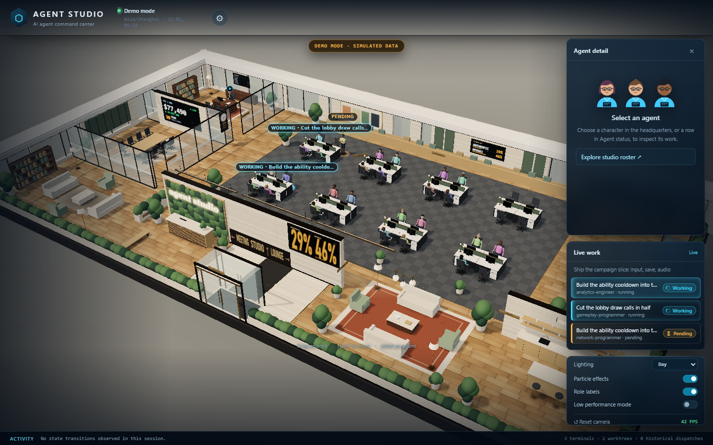

# Agent Studio

A live **three-dimensional headquarters** for multi-agent work, with a cinematic command
HUD and two desktop views of the same read-only state.

**Command Overview** (`/`) — the complete single-floor office, task lanes, active roles,
agent inspection, live events, and operational panels. Click a character to show a short
role-specific line above the floor.

**Studio Floor** (`/floor`) — the spatial-first version of the same world. The command
dashboards are hidden so the office fills the screen; the right-side Agent detail and Live work
panels remain. All 26 coding roles have stable desks in the open desk area.

**Demo** (`/demo`, or `?demo=1` on any view) — the same pages driven by a deterministic,
scripted studio run instead of `/state`. Use it on a fresh machine, between real runs, or for
screenshots. A permanent `DEMO MODE · SIMULATED DATA` banner sits on top, the connection chip
reads `Demo mode`, and no `/worker/<id>` output is requested. `?t=<seconds>` starts the 96-second
loop part-way through (`/demo?t=29` lands just before the first completion).

**Mobile** (`/mobile`) — phone-first single screen (390×844, no scrolling): quota bars, worker
counts, active agents, rooms. This is the view to open from an iPhone; see
[docs/REMOTE-CONTROL.md](docs/REMOTE-CONTROL.md).

**System Anatomy** (`/anatomy`) — not another office view. It is an isometric system map of
where state comes from (Orca, CCGS audit, Paseo, quotas), how `/state` collects it, and how the
experience views consume it. Use it to understand the data flow; use `/` for operations and
`/floor` for the spatial campus.


## The office

One 42 × 22 m floor plate in a "quiet luxury" palette. Materials differ in roughness, metalness and
relief, not only colour: oak planks with sunk joints and per-board tone, slate carpet tiles under the
pods, matte travertine, rough felt baffles, clearcoat glass with dark-bronze mullions, polished
brass, and sheen upholstery. The south and east edges are cut away so the default south-east camera
looks straight in; planter troughs run along both open edges so the plate never ends in bare slab.
The default camera frames the three glass rooms, the pods and the south band inside the window the
HUD panels leave free; `/floor`, which has no left panels, keeps a closer view. Overhead, a plaster
soffit with a bronze reveal runs along the back walls, linear brass pendants follow the main aisle
and three globe pendants hang over the lounge table. None of them is over a seat (a test checks
this). The north wall carries a framed colour-field canvas and felt acoustic panels, and a wall clock
on Shanghai time with a rooms directory hangs on the mullion between the director's office and the
meeting room. A light grade sits before the output pass. It warms highlights, cools shadows, deepens
the low end and darkens toward the frame edges, and it leaves saturated pixels alone, so the status
colours are unchanged.
Zone names are small brass plaques at each entry; the zone footprints live in `OFFICE_ZONES`
(`public/hq3d.js`).

| Zone | What happens there |
|---|---|
| **Director's office** | Glass box, north-west. The orchestrator sits at the walnut desk while a Paseo session or any worker is live; nobody else goes in |
| **Meeting room** | Two or more roles working on the same task walk here and take one of eight chairs, then walk back. The market display hangs on its travertine wall |
| **Open desk area** | 32 desks in pods of four: one per roster role (whole pods per team, alphabetical inside a team, so a seat never moves) and six spare hot-desks |
| **Main aisle** | The walk south of the pods, under a long linear brass pendant run |
| **Reception** | A south-facing travertine feature wall closes the south band. West: a plant wall with the backlit `agent studio` wordmark over a fluted-oak reception desk, the first thing the default camera meets. Centre, on the entry axis: the low wayfinding band. East end: the quota scoreboard, held below full brightness. Orca workers that map to no roster role wait at the desk, or take a hot-desk while running |
| **Lounge** | On the walkway in front of the camera: terracotta rug, two sofas, two armchairs. At most six roles resting after a completed task sit here, chosen alphabetically |
| **Pantry** | Counter run, espresso machine, island with stools, and the neon wordmark |
| **Library** | South-west, under the west glazing: sofas, armchairs and shelving |
| **Entrance** | A glass vestibule with outer and inner double doors, on a travertine arrival hall |

Every roster role always has a character **at its own desk**: `idle` sits leaning back with a dim
monitor, `working` sits and types, `pending` stands at the desk, `failed` stands turned away and
`completed` stands and celebrates. Agents walk along the aisles only when they relocate (meeting,
lounge, home); the first state after page load places everyone without replaying walks.

- **Market display.** Draws `/market` onto the meeting-room wall display: BTC/USD price, 24 h change, and
  the Fear & Greed value with its label. Refreshes every 60 s. When the feed is offline it says
  `NO SIGNAL`, never a stale or invented number.
- **Quota display.** Shows the first two providers in `state.quotas`, each with its most constrained
  remaining window (`ANTHROPIC 29%`), and `NO QUOTA DATA` when the gateway reports nothing. The
  reception scoreboard repeats it at a size that reads from the default camera (numerals ≥ 26 px
  tall at 1440×900; a test checks this); the original panel stays on the north wall.
- **Completion.** When a role is *observed* changing to `completed`, it hops and a short confetti
  burst (120 instanced pieces, 1.2 s) fires at its desk. Roles that were already completed when
  the page loaded do not celebrate. Reduced-motion preferences skip the hop and the confetti.
- **Day and night.** The lighting follows Asia/Shanghai time: day 07–17, dusk 05–07 and 17–20,
  night otherwise. At night the sky goes dark, warm pools light the rooms, the recessed ceiling
  strips, the glazing and the reception wordmark glow. Nobody leaves the floor: every role stays at its
  own desk, and status still decides the pose. The **Lighting** control
  (⚙ → Lighting: Auto / Day / Dusk / Night) overrides the clock and is remembered locally;
  `?phase=day|dusk|night` sets it from the URL. Every change cross-fades over about 1.5 s.

## 3D asset pipeline

The live floor is still procedural and has no runtime Blender dependency. An optional Blender kit
and the production path for agent-authored assets live in
[docs/BLENDER-PIPELINE.md](docs/BLENDER-PIPELINE.md), with the deterministic source at
`blender/agent_studio_kit.py`. Run `scripts/build-blender-assets.sh` when Blender is installed;
otherwise the procedural fallback remains the source of truth.

The office no longer loads the Blender kits (`public/studio-kit.glb`, `public/game-kit.glb`);
every desk, chair, monitor and room is procedural, merged per material, and the whole cast of
people is three instanced draws. A frame is about 85 draw calls including shadows and bloom.




Built on top of [Claude Code Game Studios](https://github.com/donchitos/claude-code-game-studios)
(CCGS) for its studio roster and its subagent audit hooks. No game development involved:
the roster is used as the *organizational* model.

## What it shows

| Panel | Source | Meaning |
|---|---|---|
| **Live Floor** | `orca orchestration worker-list` + `terminal list` | Every supervised Orca worker: label (the worker terminal's own title), state, liveness, terminal state, next action |
| **Subagent Activity** | `$CCGS_ROOT/production/session-logs/agent-audit.log` | Real per-role activity from CCGS's `SubagentStart`/`SubagentStop` hooks (`invoked` / `completed` / `active`) |
| **Task Board** | `orca orchestration task-list`, else `hermes kanban list` | Tasks by status lane — see *Task board sources* below |
| **Studio Roster** / floor plan | `roster.json` (generated from CCGS `.claude/agents`) | 26 roles in 2 coding rooms; a seat lights when that role is active |
| **Reception** (floor view) | same worker feed | Supervised workers as visitors, with their task label |
| **Quota scoreboard** (reception wall, repeated on the back wall) | `state.quotas` | Remaining quota for the first two providers |
| **Market TV** (meeting room) | `/market` → Coinbase BTC-USD stats + alternative.me Fear & Greed | BTC price, 24 h change, Fear & Greed; `NO SIGNAL` when offline |
| **Live Work** (`/floor` sidebar) | `/state` + `/worker/<id>` | The run on the floor, the agents behind it, the tasks in flight, and the picked worker's live tail |
| **Activity** | poll diff | Worker/task state transitions as they happen |

All interface text is **English**; runtime data (task titles, role descriptions) is shown as-is.

Every agent has exactly one status, derived only from reported fields (`agentStatuses` /
`workerStatus` in `public/studio-data.js`), in this precedence:

| Status | Evidence |
|---|---|
| **Working** | a floor worker naming the role is live and unsettled, or the audit log has an unmatched `invoked` for it |
| **Pending** | a matching dispatch is still `pending` |
| **Failed** | a matching worker or dispatch reported `failed` |
| **Completed** | a matching floor worker settled (`succeeded` / `stopped` / `cancelled`), or the role's last audit event is `completed` within 30 minutes |
| **Idle** | none of the above |

Only the floor-scoped `workers` count, never run history, and the 30-minute window keeps every
role that ever finished from reading as freshly completed. Each status carries its evidence
(`worker ctx_… · succeeded`, `audit completed 14:22`) and a `since` time only when an audit
event provides one. The HUD pairs every status with an icon and a label, never colour alone;
the scene gives each agent a status halo, a billboard badge and a desk strip in the same colours.

## Run

The 3D view loads Three.js from `node_modules` (served under `/vendor/three/`), so install the
dependencies once per clone. Without them the HUD still works and the scene area says
"3D assets are missing. Run `bun install` in the repository root, then reload."

```bash
bun install                # once: three (runtime) and playwright (visual review only)
bun run server.ts          # http://127.0.0.1:8787        (panel)
                           # http://127.0.0.1:8787/floor  (floor plan)
                           # http://127.0.0.1:8787/demo   (simulated run, clearly labelled)
bun run --hot server.ts    # same, with reload
bun run visual-review      # capture demo day / no-signal / confetti / night / floor / mobile into docs/review
```

**Market feed.** `/market` answers `{ ts, btc: { usd, change24h } | null, fearGreed: { value, label } | null, offline }`.
It reads two public endpoints with a 2.5 s timeout each, shares one 60 s cache across all
clients, and never fails: if both sources are unreachable it answers `offline: true` with nulls.
It is independent of `/state`, which stays read-only and never calls out to the network.

Environment:

| Var | Default | Purpose |
|---|---|---|
| `PORT` | `8787` | HTTP port |
| `ORCA_COORDINATOR` | unset | Coordinator terminal handle; when set, task titles/specs are read via `orca orchestration task-list --from <handle>` and used for role matching |
| `CCGS_ROOT` | `/tmp/ccgs` when present | CCGS project root holding `production/session-logs/agent-audit.log` |
| `AGENT_STUDIO_AUDIT` | unset | Point directly at an audit log file (overrides `CCGS_ROOT`) |
| `AGENT_STUDIO_TTL_MS` | `1500` | Shared `/state` cache window. Every collect spawns CLI processes, so all clients share one collect per TTL; concurrent callers join the in-flight promise. Before this, several tabs polling every 2 s queued behind each other and `/state` took ~9 s. |
| `AGENT_STUDIO_FLOOR_GRACE_MS` | `1800000` (30 min) | How long a finished run keeps its dispatches on the floor before they fade. A run that still owns a live or pending worker is never hidden, whatever this says. |
| `AGENT_STUDIO_RUN_HISTORY` | `10` | How many runs `/state` carries in `runs` for the history view, newest first. |
| `AGENT_STUDIO_AGENT_LOOKUPS` | `12` | `worker-show` lookups per collect that fill in which AI a dispatch launched. Results are cached per dispatch, so this only bounds a cold start. |
| `PATH` | inherited | **Must include the directories holding `orca` and `hermes`** — see the launchd note below |

**Floor scope.** `orca orchestration worker-list` has no run binding when a service calls it, so its
receipt says `scope.source: "all"` and it returns every dispatch of every run, newest first, forever:
a finished smoke test would keep its failures in the FAILED dial for good. `/state` therefore scopes
the floor to the newest non-legacy run that still owns a live or pending worker, else the newest run
overall. It keeps that run while it owns a live or pending worker or is within
`AGENT_STUDIO_FLOOR_GRACE_MS` of its creation, and never hides a worker that is still live or
pending — a hidden live worker would be a lie. `ORCA_COORDINATOR` is not a floor filter: it only
feeds the task board, so a run started from an omp `/team` session shows up too. The `workerScope`
field reports the run shown, whether it is live, and how many dispatches were left out; the panel
prints that under the dial.

**Task board sources.** The board has two sources, and Orca wins. When `ORCA_COORDINATOR` is set
and `orca orchestration task-list --from <handle>` returns any tasks, `/state` carries them in
`orcaTasks` (`id`, `title`, `spec`, `status`, `runId`) and the board draws one lane per Orca status
(`pending`, `ready`, `dispatched`, `running`, `blocked`, `completed`, `failed`, then any other
status it sees). With no Orca tasks it falls back to the Hermes kanban (`kanban`/`kanbanStats`)
and its eight lanes. The header note always names the source: `Orca · 20 tasks · 2 lanes` or
`Hermes · 3 tasks · 2 of 8 lanes`.

**Which AI is working.** `worker-list` reports a null `projection.agent`, so the launched agent
(and model, and terminal exit cause) is only in `orca orchestration worker-show`. The server looks
it up for the dispatches on the floor and for the newest run, caches it per dispatch — it never
changes — and the floor, the history detail and the mobile view all name it (`ORCA · claude`).

**Worker output.** `/worker/<dispatch-id>` proxies `orca orchestration worker-read --source auto`
(bounded tail) for one dispatch. The history detail opens it in an overlay and refreshes it every
two seconds while open; ids are validated, and a dispatch Orca cannot read answers `502` rather
than an empty box. Orca holds a terminal tail only while that terminal lives, so a finished
dispatch reads empty — the overlay says so, with the source, terminal status and line count.

The floor view (`/floor`) carries the same thing in its sidebar: **LIVE WORK** names the run on the
floor, the agents behind it (`working · claude ×2 · codex ×1`) and the tasks in flight, and follows
the first working worker's tail live. Click a row or a lobby figure to watch a different one. When
nothing is running it falls back to the newest run, so the card is never blank.

Everything is read-only: the server only reads CLI output and log files.

## Desktop rendering and controls

Both desktop pages use the same `public/hq3d.js` Three.js scene and `public/studio.js`
controller. There is no framework, CDN, or build step. The import map loads the installed
Three.js package through `/vendor/three/`; `/assets/` serves `public/`. Static routes reject
traversal and symlink escapes. The responsive HUD is designed for 1280×720 and above;
use `/mobile` for the phone interface.

- Drag to orbit; scroll/pinch to zoom; right-drag to pan.
- The campus navigator and Reset camera return to the full single-floor overview.
- With the canvas focused, `Home` resets the camera.
- Click a character, active role, or roster entry to inspect it. Associated dispatches
  offer **View full logs**. Clicking a worker stops automatic worker following.
- Task lanes filter the task inspector and highlight matching characters.
- Run history, audit, quotas, Paseo, and the full roster open in keyboard-accessible dialogs.
- Lighting (Auto/Day/Dusk/Night), particle and low-performance settings persist locally. Low-performance mode disables
  bloom and shadows, reduces particles, and caps rendering at 1× device pixel ratio.

The scene uses procedural geometry, instanced character parts, merged static architecture,
local canvas labels, and generated environment lighting. Animation pauses in hidden tabs;
reduced-motion preferences stop ambient movement. Normal rendering caps DPR at 1.65.
No operational activity is simulated outside `/demo`, which is labelled on every surface.
Missing state is labelled as unavailable, and failed JSON requests retain the last scene with a
retryable connection indicator.

## Verification

```bash
bun test
bun build public/hq3d.js --outdir /tmp/astra-check --target browser
PORT=8788 bun run server.ts   # separate from the 8787 service
curl -s -o /dev/null -w '%{http_code}\n' http://127.0.0.1:8788/
```

The tests cover state interpretation, non-JSON error handling, local module routing,
traversal rejection, structural geometry, roster bounds, character instancing,
stable positions across polls, the demo feed, the `/market` cache and offline path, the TV and
quota-sign copy, confetti firing only on an observed transition, nobody leaving the floor at night, every zone being furnished, the scoreboard facing the default camera at ≥ 26 px and sitting off the entry axis, the default camera holding every zone clear of the HUD, no ceiling fixture over a seat, idle agents dimmed to about 0.8, planters covering the open plate edges, and nothing in the south band hiding an agent. Route tests invoke the actual request handler without
binding a socket; they do not replace a browser/GPU check. Stop the test server with Ctrl-C.

## Run it as a service (macOS launchd)

```bash
# ~/Library/LaunchAgents/com.vincent.agent-studio.plist  →  then:
launchctl bootstrap gui/$(id -u) ~/Library/LaunchAgents/com.vincent.agent-studio.plist
launchctl kickstart -k gui/$(id -u)/com.vincent.agent-studio   # restart after editing
launchctl bootout gui/$(id -u)/com.vincent.agent-studio        # stop
```

**launchd starts with a minimal environment.** Without an explicit `PATH` in
`EnvironmentVariables`, the server cannot find `orca` or `hermes` and every panel silently
renders empty — the HTTP endpoint still answers `200`, so the failure looks like "no agents are
running" rather than an error. Set `PATH` to include `~/.local/bin` and `/opt/homebrew/bin`.

Logs: `~/Library/Logs/agent-studio.log` and `.err.log`.

## Before committing

This repo is public. A pre-commit hook blocks staged content that looks like a credential:

```bash
git config core.hooksPath .githooks   # once per clone
```

`.gitignore` also excludes `.env*`, keys, credential JSON, and logs.

## Files

- `server.ts` — Bun HTTP server: collects the sources, serves `/state`, `/market`, `/roster.json`, `/`, `/floor`, `/demo`
- `index.html` — command overview entry and local import map
- `floor.html` — focused floor entry and local import map
- `public/` — shared Three.js world, state interpretation, responsive HUD and styles
- `public/demo-state.js` — the deterministic `/demo` feed
- `tests/` — data, routing and procedural scene regression checks
- `roster.json` — generated roster: `{ rooms: [...], agents: [{ name, model, desc, room, tier }] }`
- `docs/*.png` — screenshots (redacted: repository names and local paths replaced)

## Limits

- Orca workers are generic agents (`claude`, `opencode`, `cursor`), not CCGS roles — role
  attribution comes from the task text, so an untitled or generically-titled task shows as a
  worker without a lit room.
- The audit feed only exists while Claude Code runs inside a CCGS project (the hooks live there).
- Short tasks finish faster than a poll: a worker can go from `pending` to `succeeded` between two
  polls (2 s apart). Long tasks show the pulsing "working" state.
- `hermes kanban` and `orca` must be on the server process's `PATH`.
- Desktop 3D requires WebGL 2. If GPU initialization fails, the data HUD and operational
  panels remain usable and show a renderer error.
- Character motion is a stylized representation of reported status, not a reconstruction
  of an agent's real-world actions. Matching roles to workers still depends on task text.
- Provider quotas and Paseo sessions depend on their local services. No synthetic metrics
  are substituted when a service reports nothing.
- The market TV is the only surface that depends on the public internet. Offline, it reads
  `NO SIGNAL`.
- The committed screenshots in `docs/*.png` predate the office redesign; `bun run visual-review`
  writes current ones to `docs/review/`.

## Credits

- Studio roster and audit-hook format: [Donchitos/Claude-Code-Game-Studios](https://github.com/donchitos/claude-code-game-studios) (MIT).

## License

MIT — see [LICENSE](LICENSE).
