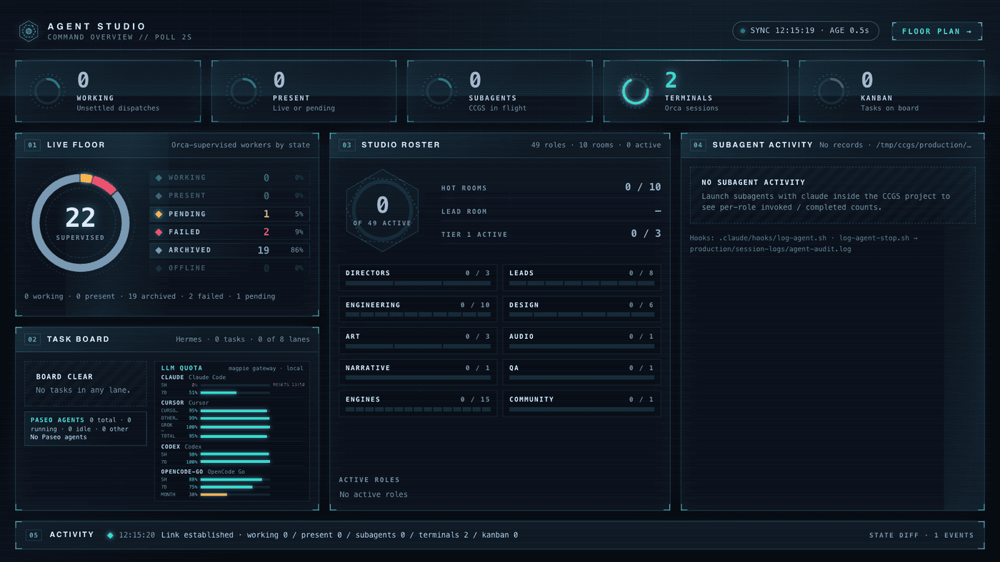
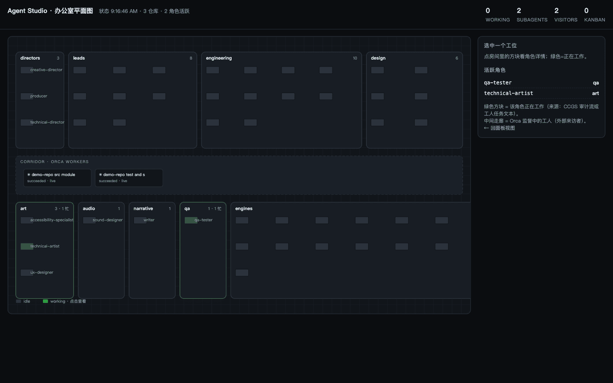

# Agent Studio

A live **studio floor** for multi-agent work: two views of the same state — a one-screen command
overview and an isometric studio tower. Both fit a single screen with no page scrolling.

**Command Overview** (`/`) — summary only: KPIs, worker-state ring, room heat, subagent totals, activity:



**Studio Tower** (`/floor`) — isometric 3D: three stacked floors, one anime-style character per role,
a lobby where Orca-supervised workers wait as visitors:



**Mobile** (`/mobile`) — phone-first single screen (390×844, no scrolling): quota bars, worker
counts, active agents, rooms. This is the view to open from an iPhone; see
[docs/REMOTE-CONTROL.md](docs/REMOTE-CONTROL.md).


Built on top of [Claude Code Game Studios](https://github.com/donchitos/claude-code-game-studios)
(CCGS) for its 49-role studio roster and its subagent audit hooks. No game development involved:
the roster is used as the *organizational* model.

## What it shows

| Panel | Source | Meaning |
|---|---|---|
| **Live Floor** | `orca orchestration worker-list` + `terminal list` | Every supervised Orca worker: label (the worker terminal's own title), state, liveness, terminal state, next action |
| **Subagent Activity** | `$CCGS_ROOT/production/session-logs/agent-audit.log` | Real per-role activity from CCGS's `SubagentStart`/`SubagentStop` hooks (`invoked` / `completed` / `active`) |
| **Task Board** | `hermes kanban list` + `stats` | The persistent task board by status lane |
| **Studio Roster** / floor plan | `roster.json` (generated from CCGS `.claude/agents`) | 49 roles in 10 rooms; a seat lights when that role is active |
| **Corridor** (floor view) | same worker feed | Supervised workers as visitors, with their task label |
| **Activity** | poll diff | Worker/task state transitions as they happen |

All interface text is **English**; runtime data (task titles, role descriptions) is shown as-is.

A role counts as active when either source says so:

1. the CCGS audit log shows an unmatched `invoked` for that role, or
2. a currently working worker's task title/spec names that role.

## Run

```bash
bun run server.ts          # http://127.0.0.1:8787        (panel)
                           # http://127.0.0.1:8787/floor  (floor plan)
bun run --hot server.ts    # same, with reload
```

Environment:

| Var | Default | Purpose |
|---|---|---|
| `PORT` | `8787` | HTTP port |
| `ORCA_COORDINATOR` | unset | Coordinator terminal handle; when set, task titles/specs are read via `orca orchestration task-list --from <handle>` and used for role matching |
| `CCGS_ROOT` | `/tmp/ccgs` when present | CCGS project root holding `production/session-logs/agent-audit.log` |
| `AGENT_STUDIO_AUDIT` | unset | Point directly at an audit log file (overrides `CCGS_ROOT`) |
| `AGENT_STUDIO_TTL_MS` | `1500` | Shared `/state` cache window. Every collect spawns CLI processes, so all clients share one collect per TTL; concurrent callers join the in-flight promise. Before this, several tabs polling every 2 s queued behind each other and `/state` took ~9 s. |
| `AGENT_STUDIO_FLOOR_GRACE_MS` | `1800000` (30 min) | How long a finished run keeps its dispatches on the floor before they fade. A run that still owns a live or pending worker is never hidden, whatever this says. |
| `PATH` | inherited | **Must include the directories holding `orca` and `hermes`** — see the launchd note below |

**Floor scope.** `orca orchestration worker-list` has no run binding when a service calls it, so its
receipt says `scope.source: "all"` and it returns every dispatch of every run, newest first, forever:
a finished smoke test would keep its failures in the FAILED dial for good. `/state` therefore scopes
the floor to the newest non-legacy run for `ORCA_COORDINATOR` (else the newest run overall), keeps
that run while it owns a live or pending worker or is within `AGENT_STUDIO_FLOOR_GRACE_MS` of its
creation, and never hides a worker that is still live or pending — a hidden live worker would be a
lie. The `workerScope` field reports the run shown, whether it is live, and how many dispatches were
left out; the panel prints that under the dial.

Everything is read-only: the server only reads CLI output and log files.

## Layout: one screen, no scrolling

Both pages render a fixed **1600×900 stage** inside `html,body{height:100%;overflow:hidden}` and scale
it to the viewport with a few lines of JS:

```js
const s = Math.min(innerWidth / 1600, innerHeight / 900);
stage.style.transform = `translate(${(innerWidth - 1600 * s) / 2}px, ${(innerHeight - 900 * s) / 2}px) scale(${s})`;
```

Measured: no page scroll, no clipping and no internal scrollbars at 1600×900 (`s=1`), 1440×900
(`s=0.9`) and 1280×800 (`s=0.8`). Fixed-size design is why the layout has no breakpoints — the stage
is the breakpoint.

`/` is deliberately **summary only** (aggregate ring, room heat, totals, one-line activity); the
per-worker detail lives on `/floor`, where clicking a character fills the side panel.

## Adding a view (the cheap way)

Both views are plain HTML files reading the same `/state` and `/roster.json`. A new view is:

1. a new `something.html` that fetches `/state` on an interval and paints,
2. four lines in `server.ts` serving it.

No build step, no framework, no new endpoint. `floor.html` is exactly that: SVG drawn once at load
from the roster, then only per-desk classes updated each poll — which is why it stays cheap at 49
desks and 2-second polling.

## Run it as a service (macOS launchd)

```bash
# ~/Library/LaunchAgents/com.vincent.agent-studio.plist  →  then:
launchctl bootstrap gui/$(id -u) ~/Library/LaunchAgents/com.vincent.agent-studio.plist
launchctl kickstart -k gui/$(id -u)/com.vincent.agent-studio   # restart after editing
launchctl bootout gui/$(id -u)/com.vincent.agent-studio        # stop
```

**launchd starts with a minimal environment.** Without an explicit `PATH` in
`EnvironmentVariables`, the server cannot find `orca` or `hermes` and every panel silently
renders empty — the HTTP endpoint still answers `200`, so the failure looks like "no agents are
running" rather than an error. Set `PATH` to include `~/.local/bin` and `/opt/homebrew/bin`.

Logs: `~/Library/Logs/agent-studio.log` and `.err.log`.

## Before committing

This repo is public. A pre-commit hook blocks staged content that looks like a credential:

```bash
git config core.hooksPath .githooks   # once per clone
```

`.gitignore` also excludes `.env*`, keys, credential JSON, and logs.

## Files

- `server.ts` — Bun HTTP server: collects the sources, serves `/state`, `/roster.json`, `/`, `/floor`
- `index.html` — panel view (no framework, no build step)
- `floor.html` — office floor plan (inline SVG, desks per role, corridor for visiting workers)
- `roster.json` — generated roster: `{ rooms: [...], agents: [{ name, model, desc, room, tier }] }`
- `docs/*.png` — screenshots (redacted: repository names and local paths replaced)

## Limits

- Orca workers are generic agents (`claude`, `opencode`, `cursor`), not CCGS roles — role
  attribution comes from the task text, so an untitled or generically-titled task shows as a
  worker without a lit room.
- The audit feed only exists while Claude Code runs inside a CCGS project (the hooks live there).
- Short tasks finish faster than a poll: a worker can go from `pending` to `succeeded` between two
  polls (2 s apart). Long tasks show the pulsing "working" state.
- `hermes kanban` and `orca` must be on the server process's `PATH`.
- The floor plan is top-down 2D on purpose: labels stay readable at 49 desks, and it needs no 3D
  or canvas code. An isometric view is possible but costs legibility, not capability.
- Characters are **generated SVG, not image assets**: hair, skin and shirt come from a hash of the
  role name, so a role always looks the same across reloads and no binary art is committed.
  Working state is animation only (typing arms, lit screen) — nothing is downloaded.
- The floor plan builds ~4,300 SVG nodes for 49 characters (chairs, arms, monitors, gradients,
  filters). Measured first paint in headless Chromium: **~5.5 s** on a cold load; the panel view is
  far lighter. It is a dashboard left open, not a page you reload often.

## Credits

- Studio roster and audit-hook format: [Donchitos/Claude-Code-Game-Studios](https://github.com/donchitos/claude-code-game-studios) (MIT).

## License

MIT — see [LICENSE](LICENSE).
